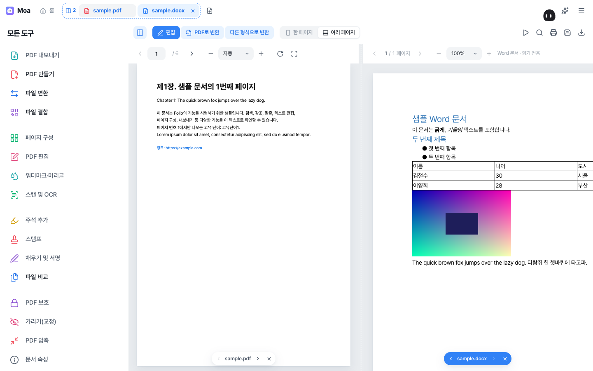
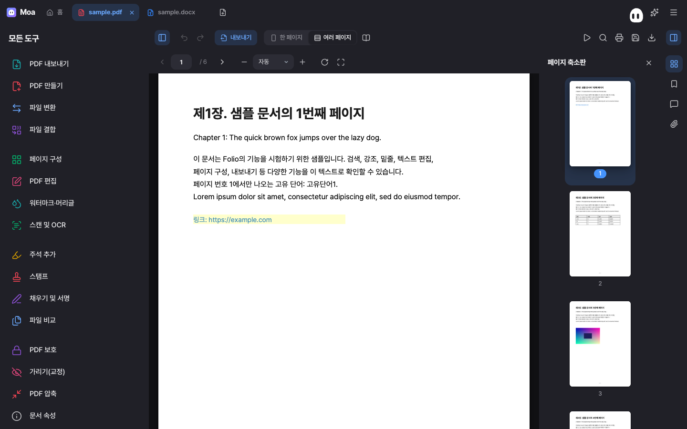

# Moa

모든 파일을 모아서 한눈에. PDF·Word·Excel·PowerPoint·한글 문서를 보고, 편집하고, 서명하고, 다른 형식으로 바꾸는 일을 모두 이 컴퓨터 안에서 처리하는 macOS·Windows용 문서 앱이에요. 파일은 어디에도 업로드되지 않아요. (예전 이름: Folio)

A fast, lightweight document app for macOS and Windows — view, edit, sign and convert PDFs and office documents, entirely on your computer.

## 다운로드

[최신 릴리스](../../releases/latest)에서 내 컴퓨터에 맞는 파일을 받으세요. 한 번 설치하면 새 버전이 나올 때 앱 안에서 알림이 뜨고, **업데이트** 버튼으로 바로 업데이트돼요.

### macOS (Apple Silicon, macOS 12 이상)
1. `Moa-<버전>-mac-arm64.zip`을 받아 압축을 풀고 `Moa.app`을 **응용 프로그램** 폴더로 옮겨요.
2. 처음 열 때: 개발자 서명이 없는 앱이라 macOS가 막을 수 있어요. `Moa.app`을 **우클릭 → 열기 → 열기**로 한 번 열면 다음부터는 바로 열려요.
   "손상되었기 때문에 열 수 없습니다"가 뜨면 터미널에서 `xattr -cr /Applications/Moa.app`을 한 번 실행하세요.

### Windows (10/11, 64비트)
1. `Moa-<버전>-win-x64.zip`을 받아 원하는 곳(예: `C:\Users\<이름>\Moa`)에 압축을 풀어요.
2. 폴더 안의 `Moa.exe`를 실행해요. 바탕화면이나 작업 표시줄에 고정해 두면 편해요.
3. "Windows의 PC 보호" 창이 뜨면 **추가 정보 → 실행**을 누르세요(서명이 없는 앱이라 처음 한 번 떠요).
4. 파일을 Moa로 열려면 파일 우클릭 → **연결 프로그램 → 다른 앱 선택 → Moa.exe**를 고르세요.

## 기능

| | |
|---|---|
| **보기** | PDF, Word(.docx), Excel(.xlsx·.xls·.csv), PowerPoint(.pptx), 한글(.hwp·.hwpx), 이미지, 텍스트·Markdown·HTML, EPUB, RTF |
| **편집** | Word·Excel·PowerPoint·한글 문서를 Moa 안에서 바로 편집 |
| **나란히 보기** | 탭을 다른 탭 위에 겹치거나 문서 영역으로 끌어다 놓으면 여러 문서를 나란히 보기 |
| **주석** | 강조·밑줄·취소선, 메모, 텍스트 상자, 그리기, 도형, 스탬프 |
| **PDF 편집** | 텍스트 수정·추가, 이미지·링크 추가, 자르기, 워터마크, 머리글/바닥글, 페이지 번호 |
| **페이지 구성** | 회전·삭제·이동·삽입·추출·분할, 여러 파일 결합 |
| **채우기 및 서명** | 양식 작성, 서명·이니셜 그리기/입력/이미지 |
| **보호** | 암호 설정·해제, 권한 제한, 가리기(영구 삭제), 압축, 문서 속성 |
| **OCR** | 스캔 문서에서 한국어·영어 텍스트 인식 → 검색 가능한 PDF |
| **비교** | 두 문서의 차이점 찾기 |
| **변환** | PDF → Word·Excel·PowerPoint·이미지·텍스트·HTML·Markdown·RTF·HWPX, 여러 형식 → PDF, 일괄 변환 |
| **AI** | 내 Claude Code·Codex 계정으로 열린 문서에 대해 묻기(버튼 한 번으로 설치) |
| **기타** | 한국어/English, 라이트·다크 테마, 버튼·배경 색, 슬라이드 쇼, 최근 파일, 마스코트 모아 |

## 알려진 제한

- HWP(바이너리) 파일은 HWPX 형식으로 저장돼요. 한글 2010 이상에서 열 수 있어요.
- PDF 텍스트 수정은 원래 글자를 덮고 새 글자를 쓰는 방식이에요.
- Word·PowerPoint·HTML → PDF 변환은 페이지 이미지 + 검색 가능한 텍스트 레이어로 만들어져요.
- OCR은 처음 실행할 때 언어 데이터를 내려받아요(이후 캐시).
